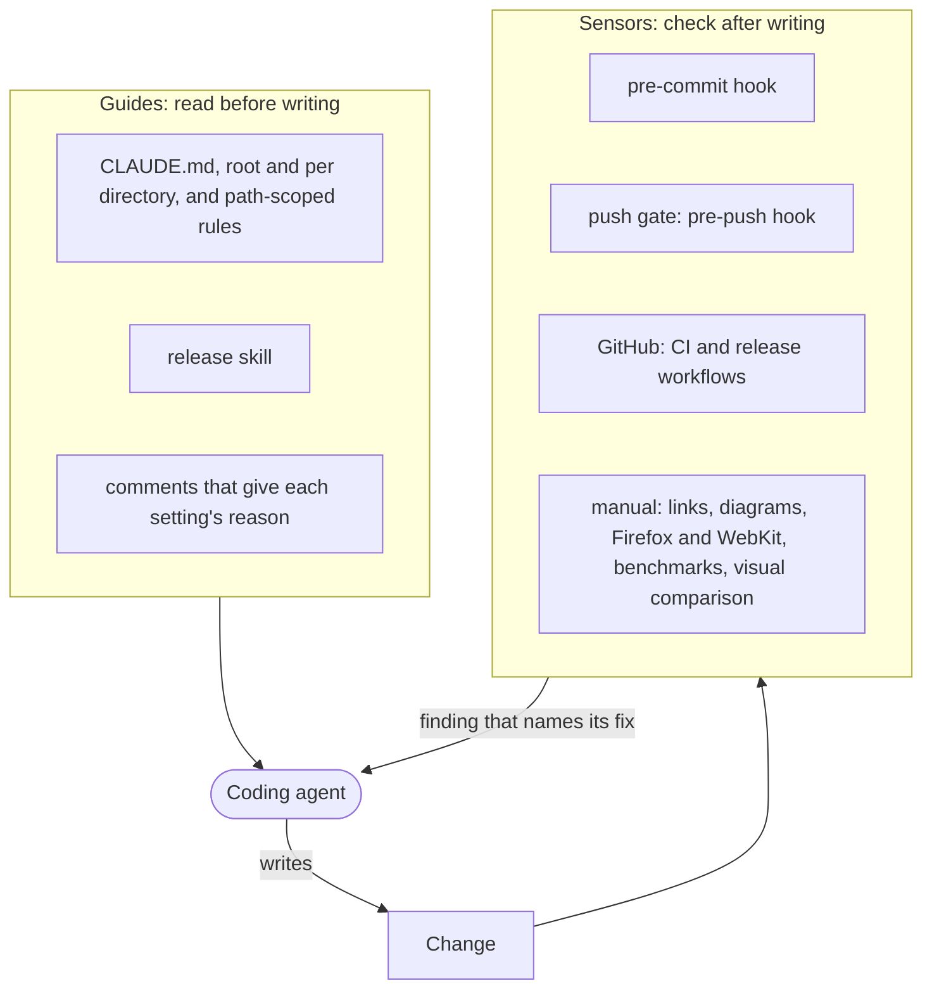
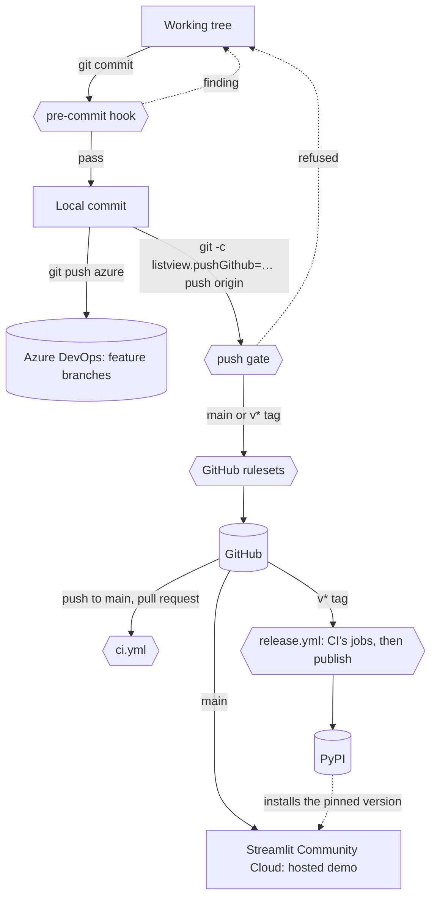
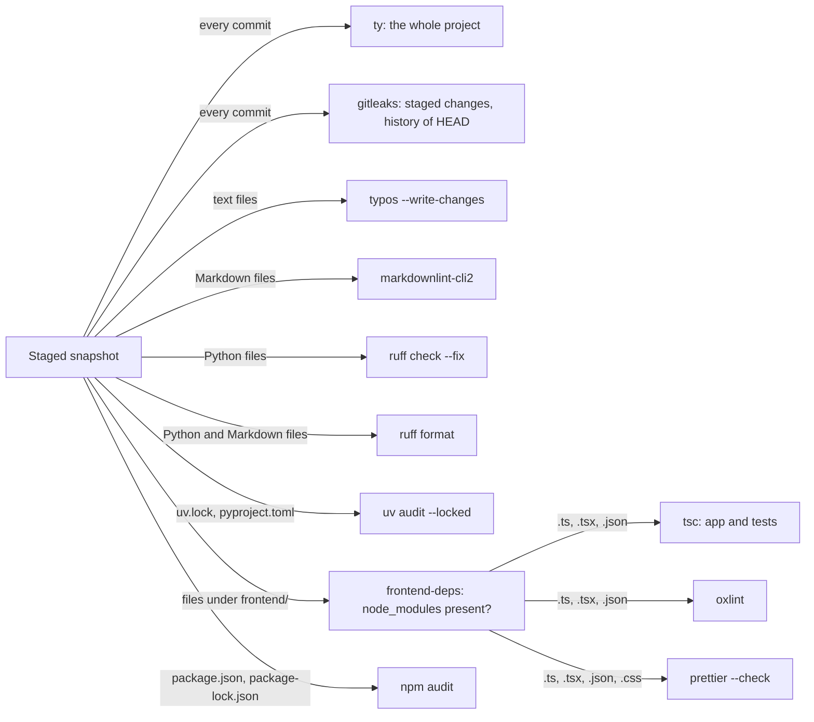
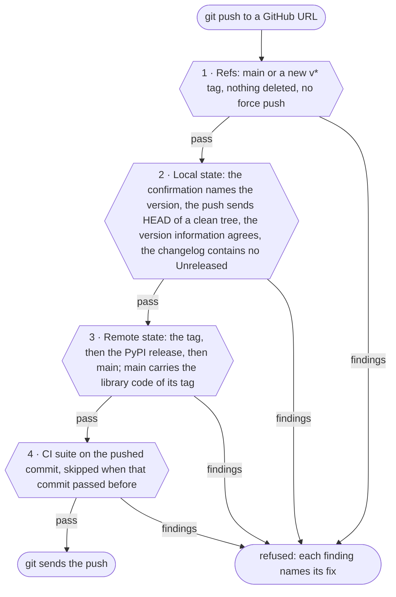
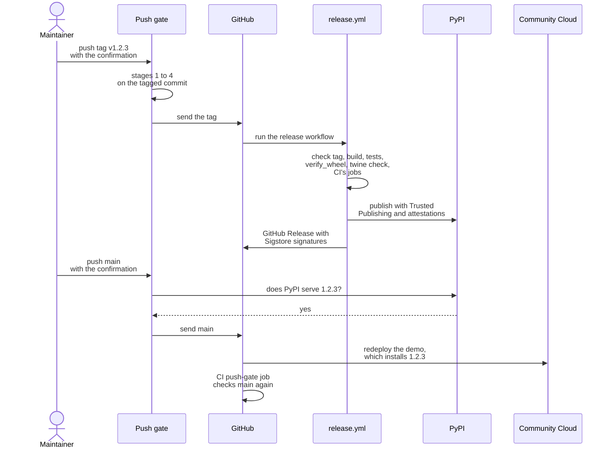
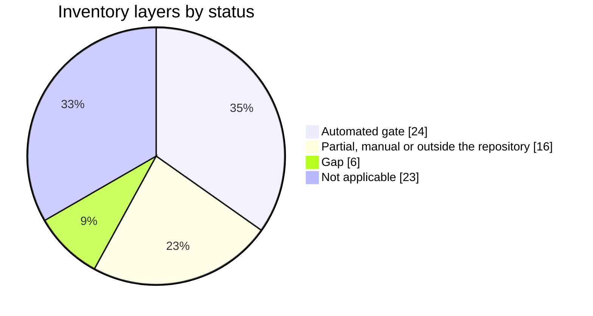
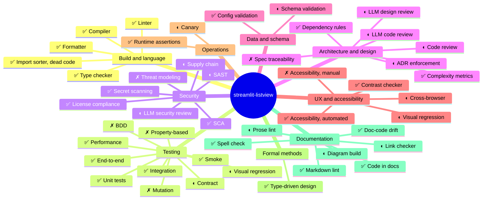

# Quality harness

This file lists the checks that guard `streamlit-listview` and shows where each one runs. Coding agents write much of the code, so the checks must catch an agent's mistake before it reaches GitHub, PyPI or the hosted demo. The set of checks is the *harness*.

The inventory below sorts the checks by the categories of the [Harness Inventory](https://llm-coding.github.io/Semantic-Anchors/harness-inventory) and summarizes them in the manner of its [Harness Coverage Wheel](https://llm-coding.github.io/Semantic-Anchors/harness-coverage-wheel.html). Update this file when a check is added, removed or moved to another stage.

## How the harness works

The harness has two halves. **Guides** tell an agent the rules before it writes: the `CLAUDE.md` files, the rules under `.claude/rules/`, the release skill and the comments in the configuration. **Sensors** check what it wrote: hooks, tests, CI and the release workflow. A sensor's finding goes back to the agent, which fixes the code and runs the check again.

Six rules shape every check:

- **A check runs on the local machine first and on GitHub again.** The local run reports a finding in seconds. The GitHub run catches a commit that skipped the hook: `ci.yml` checks every pull request and every push to `main`, and `release.yml` runs the same jobs on a release tag before it publishes. Two kinds of check run once: `twine check` only in the release job, and the manual checks only by hand.
- **A finding names its fix.** The `frontend-deps` hook says "Run npm ci", and every push gate finding gives the command that clears it. An agent can then correct its own work without a person. The inventory calls this property *closed loop*.
- **A warning fails like an error.** oxlint runs with `denyWarnings`; ruff, ty and oxlint each fail on a suppression comment that suppresses nothing.
- **A suppression is narrow and states its reason:** `# noqa: CODE` or `# ty: ignore[rule]` on one line, a per-file ignore in `pyproject.toml`, or `// eslint-disable-next-line rule -- reason`.
- **The hooks and the frontend tools are pinned; CI also tests the newest Python dependencies.** `.pre-commit-config.yaml` pins each hook: ruff, ty, uv, gitleaks, typos, markdownlint-cli2, markdown-link-check and mermaid-cli. `package-lock.json` pins the frontend tools and axe-core, and `npm ci` installs exactly that file everywhere. The ty hook, the push gate and the manual browser hook run in the environment that `uv.lock` pins, Playwright and its browser builds included. CI and the release job install the Python test environment with `uv pip install`, which takes the newest versions that `pyproject.toml` admits. They test the Streamlit, pytest and Playwright that a new user installs, so a new release of one of them can fail CI while the local checks pass. These float as well: the pre-commit that CI and the push gate fetch through `uvx`, the release's twine, the setuptools that builds the distributions, Node and Python (CI takes the newest 24 and 3.12; a developer machine runs what it has installed), the runner image, and the actions, which the workflows pin by tag. No check runs against Streamlit 1.51, the oldest version that `pyproject.toml` admits.
- **Coverage must stay at 100 %.** pytest measures the package, the demo's helpers without `demo/app.py`, the push gate, `verify_wheel.py` and the build backend. vitest measures every frontend source except the tests, the benchmarks, the test helpers and the type-only modules. A suite fails when a line or a branch there runs in no test. Coverage shows that a line ran; the assertions show that it did the right thing.

## The path of a change

A change passes up to five gates on its way to users. Feature branches go to Azure DevOps after the commit hook. Only `main` and release tags go to GitHub, and only through the push gate.

The table shows which check runs at which stage. *Push gate* means the CI suite that the push gate runs before a push to GitHub. *Release* means `release.yml`, which runs CI's jobs on the tag and publishes only when they and its own checks pass.

| Check | Tool | Pre-commit | Push gate | CI | Release | Manual |
|---|---|:-:|:-:|:-:|:-:|:-:|
| Python lint | ruff check | ✓ | ✓ | ✓ | ✓ | |
| Python format | ruff format | ✓ | ✓ | ✓ | ✓ | |
| Python types | ty | ✓ | ✓ | ✓ | ✓ | |
| Python dependency audit | uv audit | ✓ ¹ | ✓ | ✓ | ✓ | |
| Frontend types | tsc | ✓ | ✓ | ✓ | ✓ | |
| Frontend lint | oxlint | ✓ | ✓ | ✓ | ✓ | |
| Frontend format | Prettier | ✓ | ✓ | ✓ | ✓ | |
| Frontend dependency audit | npm audit | ✓ ¹ | ✓ | ✓ | ✓ | |
| Secrets | gitleaks | ✓ | ✓ | ✓ | ✓ | |
| Spelling | typos | ✓ | ✓ | ✓ | ✓ | |
| Markdown lint | markdownlint-cli2 | ✓ | ✓ | ✓ | ✓ | |
| Complexity, limit 10 | ruff, oxlint | ✓ | ✓ | ✓ | ✓ | |
| Bundle build | Vite | | ✓ | ✓ | ✓ | |
| Frontend unit tests, 100 % coverage | vitest | | ✓ | ✓ | ✓ | |
| Python unit tests, 100 % coverage | pytest | | ✓ | ✓ | ✓ | |
| Wheel contents | `verify_wheel.py` | | ✓ | ✓ | ✓ | |
| Licenses of the bundled packages | Vite, `verify_wheel.py` | | ✓ | ✓ | ✓ | |
| License allowlist | vitest | | ✓ | ✓ | ✓ | |
| Distribution metadata | `twine check --strict` | | | | ✓ | |
| Version information and changelog | `push_gate.py` | | ✓ | ✓ ² | ✓ | |
| Release order: tag, PyPI, `main` | `push_gate.py` | | ✓ | ✓ ² | ✓ | |
| Browser tests, Chromium | Playwright | | ✓ | ✓ | ✓ | |
| Accessibility and contrast | axe-core | | ✓ | ✓ | ✓ | |
| Browser tests, Firefox and WebKit | Playwright | | | | | ✓ |
| Render budget | `e2e/test_performance.py` | | ✓ | ✓ | ✓ | |
| Benchmarks | vitest bench, Playwright | | | | | ✓ |
| Visual comparison | `scripts/gif/compare.py` | | | | | ✓ |
| Links in Markdown | markdown-link-check | | | | | ✓ |
| Mermaid diagrams | mermaid-cli | | | | | ✓ |

¹ Only when the commit changes a lockfile or its manifest. CI audits on every run, so it also reports an advisory published against an unchanged lockfile.
² The `push-gate` job runs on a push to `main` only.

## The tools

The pre-commit hook picks its checks by the staged files. ty and gitleaks run on every commit. Under `streamlit_listview/frontend/`, a staged `.ts`, `.tsx` or `.json` file runs tsc, oxlint and Prettier; a staged `.css` file runs Prettier; and a staged `package.json` or `package-lock.json` runs npm audit. The `frontend-deps` hook runs first for any staged file there and stops the commit when `node_modules` is missing.

### Type checkers

- **ty** checks the whole project on every commit: the package, the demo, the scripts and the tests. `python-platform = "all"` makes Windows and Linux report the same diagnostics. The hook runs against the locked environment (`--frozen`) without installing the project, so it never builds the frontend. Two rules beyond ty's defaults close two ways for `Any` to enter typed code: `missing-type-argument` forbids a bare `dict` or `list`, and `unsound-return-statement` forbids returning `Any` from a typed function. A written `Any` stays allowed; `listview()` takes a caller's options as `Any`.
- **tsc** checks the frontend in `strict` mode twice: the app code (`npm run typecheck`, also the first step of `npm run build`) and the tests (`tsconfig.test.json`). The app configuration omits the Node types, so production code cannot call a Node API. `src/__tests__/types.test.ts` pins the wire types with `expectTypeOf`. Five flags go beyond `strict`:
  - `noUncheckedIndexedAccess` types every `array[i]` as possibly undefined. The code checks the element or calls `elementAt` (`utils/arrays.ts`), which throws when the index leaves the array. oxlint forbids `!` in production code, so no assertion silences the check.
  - `exactOptionalPropertyTypes` lets an optional property hold `undefined` only when its type names `undefined`.
  - `noPropertyAccessFromIndexSignature` requires `obj["key"]` for a key that only an index signature declares.
  - `noImplicitOverride` requires `override` on a method that replaces an inherited one.
  - `noImplicitReturns` requires every path through a function to return a value once one path does.

### Linters and formatters

- **ruff check** runs its default rule set, 413 rules in version 0.16.10, and fixes what it can. Two per-file ignores in `pyproject.toml` state their reasons.
- **ruff format** formats the Python files and the `python` blocks in Markdown files.
- **oxlint** runs its default plugins plus React (hook rules) and Vitest (focused, skipped and stray tests). It forbids `any` without a disable comment. The project uses oxlint, not ESLint, because TypeScript 7 ships no JavaScript compiler API, which typescript-eslint needs.
- **Prettier** checks the frontend format, `listview.css` included; `npm run format` fixes it.
- **typos** checks the spelling of every text file against a list of common misspellings and fixes what it can. Its exceptions live under `[tool.typos]` in `pyproject.toml`, each with its reason.
- **markdownlint-cli2** checks every Markdown file against `.markdownlint-cli2.jsonc`: the default rules, without a line-length limit.
- **The complexity limit:** ruff's C901 and oxlint's `complexity` cap a function at a cyclomatic complexity of 10. Nine functions that were above it when the cap came in still carry a suppression with the reason; an unused suppression fails, so each goes once its function drops below 10.

### Dependency scanning and pinning

- **uv audit** checks `uv.lock` against the advisory databases. `--locked` also fails when `uv.lock` disagrees with `pyproject.toml`.
- **npm audit** checks `package-lock.json`.
- **The shipped bundle comes from the lockfile.** `npm ci` installs exactly `package-lock.json` in CI, in the release job and in the push gate.
- **Two Python environments test the code.** The ty hook, the push gate's pytest and e2e steps and the manual `e2e-browsers` hook use `uv.lock` (`--frozen`, `--locked`). CI and the release job install the test environment with `uv pip install`, which takes the newest versions that `pyproject.toml` admits; the comments at those steps give the reason. The wheel bundles no Python package; it declares `streamlit >= 1.51`.
- **No bot proposes updates,** and no scheduled run repeats the audits. A new advisory surfaces at the next CI run.

### Secret scanning

- **gitleaks** runs twice on every commit: over the staged changes and over the history of `HEAD`. In CI and in the push gate nothing is staged, so the history scan catches a secret that a commit with `--no-verify` let in. CI's `lint` job checks out the whole history for it.
- **GitHub's secret scanning with push protection** is a repository setting outside git. The maintainer turns it on under *Settings → Advanced Security*.

### Tests and coverage

- **pytest** runs the unit suite over the Python package, the demo's helpers, the push gate, `verify_wheel.py` and the build backend, with branch coverage and a floor of 100 %. The measurement leaves out `demo/app.py`, which the e2e suite runs. `tests/test_demo_app.py` runs `demo/app.py` itself through Streamlit's `AppTest`, so it can change the server theme from a second thread at a set point of a run.
- **vitest** runs the frontend suite in jsdom with a floor of 100 % for statements, branches, functions and lines. The measurement leaves out the tests, the benchmarks, the test helpers and the type-only modules. `/* v8 ignore */` marks an unreachable defensive guard. jsdom runs no layout and no CSS, so the e2e suite checks what a browser renders.
- **Guard tests read the sources instead of running them.** Each locks one rule that a refactoring could break unnoticed:

  | Test | Rule it locks |
  |---|---|
  | `src/__tests__/single-file-build.test.ts` | The bundle is one JS and one CSS file, so registration finds both. |
  | `src/__tests__/markdown-xss-guard.test.ts` | No source renders raw HTML, and every link passes the URL filter. |
  | `src/__tests__/listview-css.test.ts` | The stylesheet reads Streamlit's `--st-*` variables and never `prefers-color-scheme`. |
  | `src/__tests__/notice.test.ts` | `NOTICE` credits the ported Streamlit and react-feather code and points to the licenses of the bundled npm packages. |
  | `src/__tests__/licenses.test.ts` | Every npm package that can reach the bundle carries a license that permits shipping it. |
  | `tests/test_readme.py` | The README documents every public parameter, its Python blocks compile, its badges match the declared floors and gates, and it links the tour, while `assets/` holds only the tour and the hero GIF. |
  | `tests/test_packaging.py` | The version agrees across its places, and `verify_wheel.py` rejects a malformed wheel. |
  | `tests/test_push_gate.py` | The workflows call the push gate with the full git history, and CI's `e2e` job runs the browser suite that the push gate runs. |
  | `tests/test_harness.py` | CI's `lint` job checks out the whole history for gitleaks, the hooks that need the network or a browser stay manual, and a release tag reaches PyPI only after CI's jobs pass. It also recounts this file's inventory: the summary under *Coverage*, the pie chart and the map must show the same count, and no applicable 🟢 layer may be a gap. It checks no other claim of this file. |

- **Five rules exist in both languages:** row identity, the canonical integer for new entries, the block a row renders in, the row of a new entry with dict options, and the reconciliation of the selection. The root `CLAUDE.md` names both copies of each. Both suites test the canonical-integer rule with the same input table.
- **The e2e suite** (Playwright) drives a real Streamlit server: harness apps, the demo, and regression tests for fixed rendering bugs. CI's `e2e` job, the release workflow and the push gate run it in Chromium; a manual hook runs it in Firefox and WebKit.
  - `e2e/test_accessibility.py` scans the widget with axe-core against WCAG 2.1 A and AA, in seven states and both themes. Its `color-contrast` rule is the contrast check. `e2e/test_help_popover.py` runs the same scan on a listview whose label is written as code.
  - *Gaps and next steps* lists the widget defects that the scan excepts or that make a test skip a browser. A test fails once the scan stops reporting an excepted defect, so the defect's fix removes its entry.
  - The native-parity tests compare the widget's measured colors with the native Streamlit widget on the same page, never with a hardcoded value. They run again under the dark theme.
- **The benchmarks and the visual comparison** run by hand. [BENCHMARKS.md](BENCHMARKS.md) and [scripts/gif/README.md](scripts/gif/README.md) describe them.

### Build and packaging checks

- **The build backend** (`_build_backend.py`) runs `npm run build` for every wheel, sdist and editable build. With `LISTVIEW_SKIP_NPM_BUILD=1`, or without `frontend/src`, it skips npm and fails unless `build/` holds exactly one `index-*.js` and one `index-*.css`. Before a wheel it drops setuptools' staged copy of the package in `build/lib`, whose old bundle or deleted modules would otherwise ship beside the current files, and it stops the build when it cannot.
- **Registration** requires exactly one `index-*.js` and one `index-*.css`; a second chunk fails at import.
- **`scripts/verify_wheel.py`** checks the built wheel: under `frontend/build/` exactly one JS file, one CSS file and `THIRD_PARTY_LICENSES.md`, and nothing else; no other package file that the source tree lacks; the component manifest, parsed with `toml` as Streamlit parses it (with the standard library's `tomllib` where `toml` is absent, as in the push gate), for the distribution's name, the release's version and the `listview` component with its `asset_dir`; the license files; and no `_build_backend.py`. It also checks that the file name carries the version of the root `pyproject.toml`.
- **The licenses of the bundled packages:** Vite writes every npm package the bundle carries, with its license text, into `THIRD_PARTY_LICENSES.md` next to the bundle (`build.license`), and `NOTICE` points to it.
- **`licenses.test.ts`** allows MIT, ISC, Apache-2.0, BSD-2-Clause, BSD-3-Clause and 0BSD for every npm package that can reach the bundle; a dev-only package is exempt.
- **`twine check --strict`** checks that PyPI can render the package metadata.

### Manual checks

Three pre-commit hooks in the `manual` stage run by hand: no commit, CI run or push waits for them, because their result depends on other websites or needs a browser. `pre-commit run --hook-stage manual --all-files` runs them along with every other hook, because pre-commit runs a hook without a `stages` setting in every stage, the manual one included. `pre-commit run --hook-stage manual markdown-link-check --all-files` runs one of them. The release skill runs them before each tag; no workflow records that they ran.

- **markdown-link-check** checks every link of every Markdown file, with the settings in `.markdown-link-check.json`.
- **mermaid-cli** renders every Mermaid diagram; `scripts/check_mermaid.mjs` names each file whose diagram fails.
- **e2e-browsers** runs the e2e suite in Firefox and WebKit; a test that holds only in some browsers carries `only_browser` or `skip_browser` with its reason.
- **The README's tour link** points to `raw.githubusercontent.com/.../HEAD/assets/`, which GitHub serves only after `main` reaches it, and the release pushes `main` last. The link check therefore checks such a link against the file in `assets/`.
- **The hosted demo** (`st-listview-demo.streamlit.app`) answers a scripted request with a redirect to Community Cloud's login, so the link check skips it.

### The push gate

`scripts/push_gate.py` runs as a pre-push hook. A push to any host but GitHub passes at once. A push to GitHub passes four stages; each stage reports all its findings, and a stage runs only when every earlier stage passed.

The confirmation `git -c listview.pushGithub=<version>` counts only on the command line, so no configuration file can approve a push in advance. A push to GitHub without it fails. `CLAUDE.md` (*Pushing to GitHub*) gives the commands.

Stage 4 runs once per commit. The push gate records each commit whose suite passed and skips the suite, the audits included, when that commit is pushed again. An advisory published since then surfaces in the GitHub run.

### On GitHub

- **`ci.yml`** runs three jobs on every pull request and every push to `main`: `lint` (all pre-commit hooks on all files), `test-build-verify` (build, both test suites, wheel, `verify_wheel.py`) and `e2e` (the browser suite in Chromium). A push to `main` adds a fourth, `push-gate` (`push_gate.py check main`).
- **`release.yml`** runs on a `v*.*.*` tag. Its `build` job checks the tag with `push_gate.py check tag`, which fails a tag that disagrees with the version information, then builds, tests and checks the distributions. Its `ci` job runs `ci.yml`'s three jobs on the tagged commit, because `ci.yml` runs on no tag by itself and `main` reaches GitHub only after PyPI. Only when both jobs pass does the workflow publish the distributions to PyPI through Trusted Publishing, without a stored token, together with PEP 740 attestations. It then signs them with Sigstore for the GitHub Release.
- **Each workflow token gets least privilege:** `contents: read` by default; `id-token: write` only for publishing and signing; `contents: write` only for the job that creates the GitHub Release.
- **Rulesets** in the repository settings protect what the push gate lets through: `main` cannot be deleted or force-pushed, a `v*` tag cannot be moved or deleted, and no other branch can be created or updated. They live outside git; check them under *Settings → Rules*.

The release order keeps the hosted demo on a published version:

## Guides for the coding agent

| Guide | Loads | Holds |
|---|---|---|
| `CLAUDE.md` | every session | the commands, the invariants that span both languages, CI, the push gate, the writing rule |
| `streamlit_listview/CLAUDE.md` | when Claude reads a file there | id rules, row identity, new entries, the `format_func` contract |
| `streamlit_listview/frontend/CLAUDE.md` | when Claude reads a file there | selection state, render chunks, the `data-testid`s |
| `.claude/rules/frontend-theming.md` | when Claude reads a file its `paths` name: the stylesheet, its tests and the theme probes | theming, the sidebar swap, surface pairs, painted states |
| `demo/CLAUDE.md` | when Claude reads a file there | the widget key, the presets, the theme switcher, the deployment |
| `.claude/skills/release/SKILL.md` | on `/release` or a request to release | the release checklist and the order of the pushes |
| `BENCHMARKS.md`, `scripts/gif/README.md`, this file | on request | the benchmarks, the GIFs, the harness |

The guides state rules that the sensors cannot check:

- **Fix a failing hook; never pass `--no-verify`.**
- **Change both copies of a rule that exists in both languages.**
- **Regenerate the hero GIF in the commit that changes how the widget looks.**
- **Write every document in plain English after Strunk & White.**

Comments next to the settings in `pyproject.toml`, `.pre-commit-config.yaml`, `.oxlintrc.json` and the workflows give each setting's reason, so an agent does not undo a deliberate choice.

## Layers outside the repository

The maintainer develops with Claude Code. Their setup adds layers that the repository neither holds nor enforces, so another contributor's agent does not run them:

- **Design before code:** an agent drafts a design and a written spec; the maintainer approves both, then a plan.
- **Tests first:** the agent writes each test, watches it fail, then writes the code.
- **AI review before a merge:** a whole-branch review by a fresh agent, an AI code review that applies its fixes, and an AI security review.
- **Only the maintainer pushes.** The agent commits locally; the maintainer decides what leaves the machine.

## Harness inventory

The tables follow the nine categories of the Harness Inventory and list each of its layers.

- **Def** is the inventory's class. 🟢 *extrinsic*: an outside standard defines right and wrong, so turning the tool on suffices. 🟡 *hybrid*: an outside default that the project tunes. 🔴 *intrinsic*: the project must define right and wrong itself.
- **Status:** ✅ automated gate: runs without a person and blocks. ◐ in place, but partial, manual or outside the repository. ✗ gap: the layer applies, but nothing covers it. — not applicable: none of the project's parts needs the layer, neither the library, the hosted demo nor the build and release tooling; the row gives the reason.
- **Closed loop:** whether an agent can read the output and fix the code without a person.

### 1. Build and language

| Layer | Def | Status | In this project | Stage | Closed loop |
|---|:-:|:-:|---|---|---|
| Compiler | 🟢 | ✅ | `npm run build`: tsc, then the Vite production build | push gate, CI, release, every wheel build | yes |
| Type checker | 🟢 | ✅ | ty over the whole project, with two rules against `Any`; tsc in `strict` mode with five more flags over app and tests | pre-commit, push gate, CI, release | yes |
| Formatter | 🟢 | ✅ | ruff format, also in Markdown; Prettier | pre-commit, push gate, CI, release | yes |
| Import sorter, dead code | 🟢 | ✅ | ruff sorts imports (I001) and flags unused imports (F401); oxlint flags unused variables | pre-commit, push gate, CI, release | yes |
| Linter | 🟡 | ✅ | ruff's default rule set; oxlint with React and Vitest rules, warnings fail | pre-commit, push gate, CI, release | yes |

### 2. Testing

| Layer | Def | Status | In this project | Stage | Closed loop |
|---|:-:|:-:|---|---|---|
| Unit tests | 🔴 | ✅ | pytest and vitest, each with a 100 % coverage floor | push gate, CI, release | yes: the report lists the missed lines |
| Property-based, fuzz | 🔴 | ✗ | none; table-driven tests list the inputs by hand | — | — |
| Mutation testing | 🔴 | ✗ | none | — | — |
| Integration tests | 🔴 | ✅ | the push gate's tests push through the installed hook with real git; CI builds a real wheel and inspects it; the e2e suite runs Python and the browser frontend together | push gate, CI, release | yes |
| Contract tests | 🔴 | ◐ | both suites test the canonical-integer rule with one input table, kept in step by hand; `types.test.ts` pins the wire types | push gate, CI, release | yes |
| BDD, acceptance | 🔴 | ✗ | no executable specification; the e2e suite drives the user flows | — | — |
| End-to-end, UI | 🔴 | ✅ | Playwright against a real Streamlit server, in Chromium | push gate, CI, release | yes |
| Snapshot, visual regression | 🔴 | ◐ | `compare.py` diffs GIF recordings by hand, and a person judges the report; the native-parity tests measure colors against the native widget in the push gate, CI and the release | manual, push gate, CI, release | partial |
| Performance, benchmark | 🔴 | ✅ | a render budget in `e2e/test_performance.py`; the two benchmark tiers run by hand, without thresholds | push gate, CI, release | yes, for the budget |
| Smoke tests | 🔴 | ✅ | the README example and the demo boot without an exception; no check after Community Cloud redeploys | push gate, CI, release | yes |

### 3. Security

| Layer | Def | Status | In this project | Stage | Closed loop |
|---|:-:|:-:|---|---|---|
| Secret scanning | 🟢 | ✅ | gitleaks over the staged changes and the history of `HEAD`; GitHub's secret scanning is a repository setting | pre-commit, push gate, CI, release | yes |
| SCA (known vulnerable dependencies) | 🟢 | ✅ | uv audit and npm audit | pre-commit, push gate, CI, release | yes |
| Container, image scanning | 🟢 | — | no image ships | — | — |
| IaC scanning | 🟢 | — | no infrastructure code | — | — |
| Supply chain | 🟢 | ◐ | the bundle built from `package-lock.json`; Trusted Publishing; PEP 740 attestations; Sigstore signatures; least-privilege tokens. Actions are pinned by tag, not by SHA; the pre-commit that CI and the push gate fetch, the release's twine and the setuptools that builds the distributions float; no SBOM ships | CI, release | partial |
| Compliance scanning | 🟢 | — | no policy applies | — | — |
| License compliance | 🟢 | ✅ | `licenses.test.ts` allows only permissive licenses for the npm packages that ship; the wheel carries their texts in `THIRD_PARTY_LICENSES.md`; `notice.test.ts` checks the credits for ported code | push gate, CI, release | yes |
| SAST | 🟡 | ◐ | `markdown-xss-guard.test.ts`; three bandit rules in ruff (S102, S110, S112); no CodeQL or Semgrep | pre-commit, push gate, CI, release | yes |
| DAST | 🟡 | — | no server ships | — | — |
| IAST | 🟡 | — | no server ships | — | — |
| LLM security review | 🟡 | ◐ | an AI security review before each merge | maintainer | yes |
| Threat modeling | 🔴 | ✗ | none written | — | — |

### 4. Architecture and design

| Layer | Def | Status | In this project | Stage | Closed loop |
|---|:-:|:-:|---|---|---|
| Complexity metrics | 🟢 | ✅ | ruff C901 and oxlint `complexity`, limit 10; nine older functions carry a suppression with the reason | pre-commit, push gate, CI, release | yes |
| API contract lint | 🟡 | — | no HTTP API | — | — |
| Fagan inspection | 🔴 | — | one maintainer | — | — |
| Code review | 🔴 | ◐ | the maintainer reviews and pushes; GitHub requires no pull request | maintainer | indirect |
| LLM code review | 🟡 | ◐ | a whole-branch review by a fresh agent, and an AI code review with fixes before each merge | maintainer | yes |
| Dependency rules (ArchUnit, dependency-cruiser) | 🔴 | ✅ | the guard tests: one bundle chunk, no raw-HTML renderer, only `--st-*` variables; the app's tsconfig omits the Node types | pre-commit, push gate, CI, release | yes |
| ADR enforcement | 🔴 | ◐ | the `CLAUDE.md` files record the invariants and their reasons; tests enforce some of them | push gate, CI, release | partial |
| Spec traceability | 🔴 | ✗ | a spec and a plan guide each change, then leave the repository at the merge | — | — |
| ATAM | 🔴 | — | the `CLAUDE.md` files record each architecture trade-off with its reason, such as the selection state in the frontend and render chunks instead of virtualization; one component with one maintainer needs no formal evaluation | — | — |
| Schema diff | 🔴 | — | no database | — | — |
| LLM design review | 🔴 | ◐ | the maintainer approves an AI-drafted design and spec before code is written | maintainer | yes |

### 5. Data and schema

| Layer | Def | Status | In this project | Stage | Closed loop |
|---|:-:|:-:|---|---|---|
| JSON Schema, OpenAPI validation | 🟡 | ◐ | no schema; `listview()` validates every argument before the JSON boundary, and TypeScript types the payload | runtime, CI, release | yes |
| Database migration dry-run | 🟡 | — | no database | — | — |
| PII scanner | 🟡 | — | the repository holds no personal data; the caller's options pass through the widget, and the selection stays in the caller's Streamlit session | — | — |
| Config validation | 🔴 | ✅ | the push gate checks the version in five places, `uv.lock` and the changelog; `test_packaging.py` and `verify_wheel.py` parse the component manifest; `uv audit --locked` fails on a stale `uv.lock` | pre-commit, push gate, CI, release | yes |
| Data contract | 🔴 | — | no data pipeline | — | — |

### 6. UX, accessibility, internationalization

| Layer | Def | Status | In this project | Stage | Closed loop |
|---|:-:|:-:|---|---|---|
| Accessibility, automated | 🟢 | ✅ | axe-core scans the widget against WCAG 2.1 A and AA in seven states and both themes; unit tests assert the listbox and tree roles and the ARIA states | push gate, CI, release | yes |
| Contrast checker | 🟢 | ✅ | axe-core's `color-contrast` rule, in both themes | push gate, CI, release | yes |
| Cross-browser tests | 🟢 | ◐ | the e2e suite in Firefox and WebKit, a manual hook that the release skill runs | manual | yes |
| UI prose lint | 🟢 | — | the caller writes the label, the options and the help; the widget's own text is a few short English strings, such as *Select all*, *Clear search* and three hints for a refused new entry, reviewed with the code | — | — |
| Accessibility, manual | 🟡 | ✗ | no screen-reader audit | — | — |
| i18n lint | 🟡 | — | the widget's own strings are English only, by design; the caller can replace the search placeholder and the ungrouped label, but not the accessible names and the hints | — | — |
| Visual regression | 🔴 | ◐ | GIF comparison and native-parity tests, as under *Testing* | manual | partial |

### 7. Operations and runtime

| Layer | Def | Status | In this project | Stage | Closed loop |
|---|:-:|:-:|---|---|---|
| Distributed tracing | 🟢 | — | a library runs inside the caller's app | — | — |
| Canary, progressive delivery | 🟡 | ◐ | a release candidate reaches the hosted demo through its exact pin before the final release; the push gate keeps the release order | push gate | yes |
| Anomaly detection | 🟡 | — | no service of its own; the hosted demo is a showcase without a service level | — | — |
| Runtime assertions | 🔴 | ✅ | `listview()` raises on an invalid argument; registration fails unless exactly one JS and one CSS file match; the build backend fails without a bundle | runtime, build | yes |
| Health checks | 🔴 | — | Community Cloud runs the demo | — | — |
| Observability gates | 🔴 | — | no service of its own; the hosted demo is a showcase without a service level | — | — |
| Chaos engineering | 🔴 | — | no service of its own; the hosted demo is a showcase without a service level | — | — |
| Feature flags | 🔴 | — | a library ships no flags | — | — |

### 8. Formal methods

| Layer | Def | Status | In this project | Stage | Closed loop |
|---|:-:|:-:|---|---|---|
| Symbolic execution | 🟢 | — | no safety-critical path | — | — |
| Type-driven design | 🟢 | ✅ | tsc with `noUncheckedIndexedAccess` and four more strict flags, and no `!` in production code; ty forbids bare generics and `Any` returns; one `Id` type carries the id rule to every field | pre-commit, push gate, CI, release | yes |
| Formal verification | 🔴 | — | no safety-critical path | — | — |
| Model checker | 🔴 | — | no protocol of its own: the widget takes part in Streamlit's rerun, and tests cover the orderings that matter, such as a selection write-back, a superseded scroll request and a theme switch from a second thread | — | — |

### 9. Documentation and spec

| Layer | Def | Status | In this project | Stage | Closed loop |
|---|:-:|:-:|---|---|---|
| Markdown lint | 🟢 | ✅ | markdownlint-cli2 with the rules in `.markdownlint-cli2.jsonc` | pre-commit, push gate, CI, release | yes |
| Link checker | 🟢 | ◐ | markdown-link-check, a manual hook that the release skill runs | manual | yes |
| Code-in-docs validation | 🟢 | ✅ | `test_readme.py` compiles the README's Python blocks; the e2e suite runs `example.py`; the demo's code generator is tested by running its output | push gate, CI, release | yes |
| Spell check | 🟢 | ✅ | typos over every text file; it fixes what it can | pre-commit, push gate, CI, release | yes |
| Diagram build | 🟢 | ◐ | mermaid-cli renders every Mermaid diagram, a manual hook that the release skill runs | manual | yes |
| Prose lint | 🟡 | ◐ | the writing rule in `CLAUDE.md`; reviews apply it, no tool checks it | maintainer | partial |
| Doc-code drift | 🔴 | ✅ | `test_readme.py` and `test_packaging.py` tie the README and the version to the code; a test ties the workflows to the push gate; `test_harness.py` ties this file's summaries to its inventory | push gate, CI, release | yes |

## Coverage

Of the 69 layers, 23 do not apply to this project: a client-side library, its hosted demo and the tooling that builds and checks them. Of the 46 that apply, 24 run as automated gates and 16 more are in place in part; 6 are gaps. As the Coverage Wheel warns, this measures breadth, not strength: one tick says nothing about how well a layer is set up. `tests/test_harness.py` recounts the tables and fails when this paragraph, the pie chart or the map disagrees with them.

The map shows each layer that applies, by category: ✅ automated gate, ◐ partial, ✗ gap.

## Gaps and next steps

The package is a public library on PyPI, so the inventory's risk tier 3 (*customer-facing app, public API*) applies. Every applicable 🟢 layer has a check, and `tests/test_harness.py` fails when one becomes a gap. Three of them run by hand: the link check, the diagram build and the e2e suite in Firefox and WebKit; the release skill runs them before each tag. The supply chain counts as partial: the workflows pin actions by tag on purpose; the pre-commit that CI and the push gate fetch, the release's twine and the setuptools that builds the distributions float, and no SBOM ships.

No widget defect is open: the accessibility scan excepts none, and no e2e test skips a browser for one.

Tier 3 still asks for these steps:

| Step | Closes | Effort |
|---|---|---|
| Write property-based tests (Hypothesis, fast-check) for the id and option rules in both languages | property-based tests; strengthens the contract tests | a day |
| Compare screenshots against stored baselines on one CI image | visual regression as a gate | a day |
| Audit each release with a screen reader | manual accessibility | an hour per release |
| Write the acceptance criteria of a change as executable scenarios | BDD | part of each change |
| Run the manual hooks and the audits on a schedule in CI | the three manual layers as gates; advisories between two pushes | an hour |

Mutation testing belongs to tier 4. It would show how many of the tests that reach 100 % coverage also detect a changed line. A threat model and spec traceability stay open as well.
